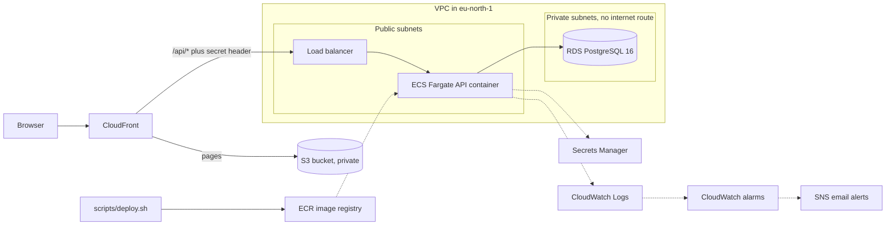

# AWS deployment

This project also runs on AWS, defined entirely as Terraform code in `infra/`. The Render and Vercel deployment still works and is unchanged, so the same code runs in both places. The settings file reads either a single `DATABASE_URL` or separate database variables, and the `/api` prefix is switched on by an environment variable.

## Architecture

One CloudFront address serves everything. Page requests go to a private S3 bucket that only CloudFront can read. Requests under `/api/*` go to the load balancer, which forwards them to the API container only when a secret header added by CloudFront is present. A small CloudFront Function sends page paths without a file extension to `index.html` so the single page app works on refresh, while API errors pass through untouched.

## Design choices

- **No NAT gateway.** The API containers sit in public subnets with a public address but are locked down by security groups, which saves about 33 USD a month. The database sits in private subnets with no route to the internet.
- **Security groups chain together.** CloudFront's address list can reach the load balancer, the load balancer can reach the containers on port 8000, and the containers can reach the database on port 5432. Nothing else is allowed in.
- **No passwords in code or files.** RDS creates and stores its own master password in Secrets Manager. The token signing key is generated by Terraform and stored in Secrets Manager. The execution role can read exactly those two secrets.
- **Least privilege roles.** The task role has no permissions. The execution role can pull one image, write to one log group and read two secrets.
- **Small and cheap on purpose.** Graviton (ARM) containers at 0.25 vCPU and 512 MB, a single zone database, and 14 day log retention.
- **Safe deploys.** The service has a circuit breaker that rolls back a broken release, and the deploy script also fails if the service ended up on the old revision.
- **Alerts.** Three CloudWatch alarms email an SNS topic: no healthy container, a burst of server errors, and low database storage.

## Cost

| Piece | Approx. per day |
|---|---|
| RDS db.t4g.micro with 20 GB | 0.45 USD |
| Application Load Balancer and its public addresses | 0.80 USD |
| Fargate container and its public address | 0.40 USD |
| Everything else (secrets, logs, S3, CloudFront at this traffic) | under 0.05 USD |

About 1.70 USD a day, or about 51 USD a month, while it is running. Destroy it when you are not using it.

## Build it from nothing

Run these from a terminal signed in with `aws login`. The first two steps are done once per account.

1. Create a private, versioned S3 bucket for Terraform state, named in `infra/versions.tf`.
2. Create an SNS topic called `jobtracker-alerts` and confirm the email subscription by clicking the link AWS sends.
3. `cd infra && terraform init`
4. Create only the image repository first: `terraform apply -target=aws_ecr_repository.backend -target=aws_ecr_lifecycle_policy.backend`
5. Build and push the first image to that repository, tagged with the short git commit id.
6. Create everything else: `terraform apply -var image_tag=<that tag> -var api_desired_count=1`
7. From the repo root run `scripts/deploy.sh`. It runs the database migration, updates the service and publishes the frontend.

The site address is printed as `site_url` at the end of the apply.

## Everyday deploys

Commit your changes, then run `scripts/deploy.sh` for everything, `scripts/deploy.sh backend` for the API only, or `scripts/deploy.sh frontend` for the pages only. It builds an ARM image tagged with the commit id, registers a new task definition revision, runs `alembic upgrade head` as a one-off task and stops if that fails, updates the service, then builds and uploads the frontend and refreshes the page cache. It needs Docker running and Node 22.

## Tear it down

Run `terraform destroy` in `infra/`. The image repository, the frontend bucket and the secrets are set up to be removed without a waiting period, and the database is deleted with no final snapshot. The state bucket and the alerts topic are left in place on purpose.

## Known limits

- **CloudFront to load balancer is plain HTTP.** It is restricted to CloudFront's address list and a secret header, but not encrypted. Encrypting that hop needs a custom domain and a certificate.
- **The API connects as the database master user.** A smaller app only user would be better.
- **Backups are kept for 1 day, and the database is single zone.** The free plan caps backup retention, and a standby copy doubles the database cost.
- **No GitHub Actions deploy.** The preferred design used OIDC so no AWS keys would be stored anywhere, but the account's organization policy explicitly blocks the OIDC actions. GitHub Actions runs the tests, and deploys use `scripts/deploy.sh` from a signed in terminal.
- **Image scan findings.** The base image has a few HIGH findings in Debian system libraries. They were reviewed and accepted for a short lived stack, and the image should be rebuilt on a fresh base before any long running deploy.
